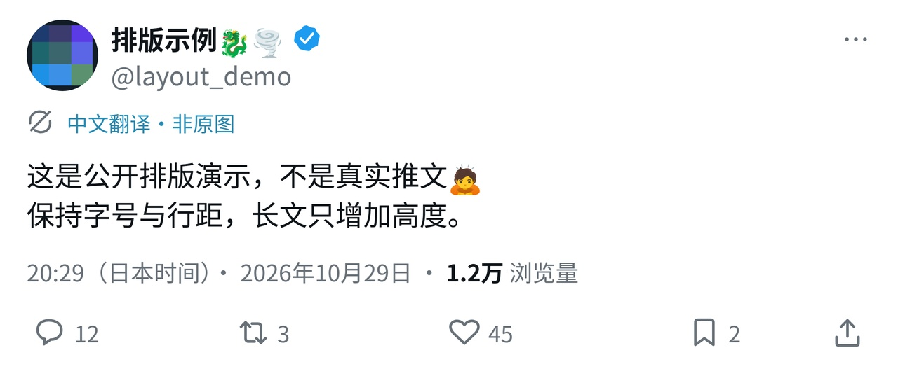

# 推文中文翻译排版器

本机运行的中文译图工具：结构化输入 → 固定 HTML/CSS 排版 → 锁定 Chromium 输出 PNG → 人工核对。支持网页编辑、JSON 批量输入、命令行、1–4 张配图、完整引用帖，以及回复/转推关系。

不调用图像生成模型或翻译 API，不抓取账号，不自动发布动态或评论。头像和配图嵌入输入文件字节，默认保留配图完整画面及比例。程序只监听 `127.0.0.1`。

自有代码采用 [MIT](LICENSE)，第三方字体和组件适用各自许可，见 [THIRD_PARTY_NOTICES.md](THIRD_PARTY_NOTICES.md)。公开版本使用自制几何头像、配图和虚构帖子；不包含用户原始参考截图、真实头像、私人工作记录或登录凭据。



## 快速启动

需要 Node.js 24+。固定字体已随源码附带，首次安装还需下载免费依赖和对应浏览器：

```sh
git clone https://github.com/l15109514775-ai/tweet-zh-compositor-open-source.git
cd tweet-zh-compositor-open-source
npm ci
npm run setup
npm run doctor
npm start
```

打开 <http://127.0.0.1:4317>。`npm start` 先实际生成一张警告预览，确认本机字体、浏览器和 PNG 导出可用后才启动网页。保持终端运行，Ctrl+C 停止。Windows 也可以双击 `安装依赖.cmd`、`启动排版器.cmd`。

首次安装需要网络，后续启动和排版使用本机文件与浏览器。无需账号、密钥、付费服务或云环境。Linux 的 Chromium 系统依赖要求及用户目录离线包构建见 [OFFLINE_LINUX.md](OFFLINE_LINUX.md)。

## 使用

网页中上传头像、配图和真实原帖截图，填写永久链接、推文 ID、作者、原文、最终中文译文、时间与时区；确认配图数量和引用层级后预览。修改译文会撤销核对确认；处理期间修改数据会丢弃旧响应。

逐层核对真实来源和译文后导出成品。缺截图、缺引用、缺字、无效时间、未核对的数据等严重问题会阻止成品 PNG；可以生成明确标记的警告预览。未提供的互动数字保持留空，只有显式提供 0 才显示 0。认证标记需要已确认的来源说明。

正文保持固定字号、行距，长文仅延长画布。每张图标注“中文翻译·非原图”。支持中日文、emoji、换行、网址和长账号。发布时间可切换日本/北京时间，正文中的相对时间保持原样，需要解释时使用译注。

```sh
# 六个显式测试样例，仅生成带警告的预览
npm run render -- --input examples/batch.json --out ./outputs/demo --mode preview

# 自己已核对的真实数据；图片相对路径以 JSON 所在目录为基准
npm run render -- --input /absolute/path/post.json --out /absolute/path/rendered --mode publish
```

`publish` 只表示导出本机成品 PNG，不向外部平台发送任何内容。退出码 0 表示确实生成所请求的 PNG；1 表示运行异常或缺少锁定浏览器；2 表示输入/成品校验阻止 PNG。带警告且实际生成 PNG 的预览可以返回 0。批量输入为 JSON 数组，每批最多 100 条。

## 输入与输出

完整输入约束见 [src/schema.json](src/schema.json)，单条样例见 [examples/short.json](examples/short.json)，引用帖见 [examples/quote-three-media.json](examples/quote-three-media.json)。每个帖子包含：

| 字段 | 用途 |
| --- | --- |
| `id`, `url`, `author` | 永久链接、数字 ID、昵称/账号、头像及可选认证依据 |
| `originalText`, `translation` | 原文及完整中文译文，不自动翻译 |
| `publishedAt`, `sourceTimezone` | 带偏移的 ISO 8601 时间，例如 `2026-10-29T20:29:00+09:00` |
| `sourceScreenshot` | 真实截图文件、带时区的采集时间、人工核对状态 |
| `sourceMediaCount`, `sourceQuote` | 已核对的原帖配图数，以及 `none/present/unknown` 引用状态 |
| `media` | 0–4 张图片、`complete/cropped/unknown` 完整性、核对状态与可选说明 |
| `quote`, `relationship` | 完整嵌套帖子，及原创/回复/转推关系和原作者信息 |
| `metrics`, `notes`, `review` | 可选互动数字、独立译注、人工核对确认 |

引用层使用完整帖子结构。回复/转推必须保留原作者昵称、账号和原帖链接；转推必须包含原帖层。OCR 结果不能绕过人工核对。

默认导出 2560px 宽 PNG、可移植输入 JSON、原始输入、JSON/文本检查报告和含原字节素材的 ZIP。文件名包含作者及 ID，目录摘要区分不同输入和素材。报告检查译文逐字一致、引用完整、图片字节哈希、比例、缺字、溢出和时间格式。超过安全画布上限时停止，不缩字或截文。

用户上传区在 `workspace`，成品在 `outputs`，浏览器及安装缓存在 `runtime`。这些目录均不纳入 Git。相同模板、字体、浏览器和运行环境下验证输出稳定；不保证跨操作系统像素一致。

## 验证

```sh
npm test
# 网页服务运行时另起终端
node scripts/ui-smoke.mjs
```

自动测试覆盖 22 个场景，网页/接口检查覆盖 12 项。公开版执行记录见 [acceptance/README.md](acceptance/README.md)。六个样例均为 `testFixture: true`，预期为 `blocked` 且输出警告预览；这不代表测试失败。它们不能代替真实推文的人工验收。

公开示例图只用于几何回归，不包含最初的私人校准图。模板默认宽 1280 CSS px、正文 40px、行距 56px、2 倍导出；参数沿用已校准布局。默认配置、模板源、示例图和字体都通过哈希锁定，改模板需升级版本并重建锁。

## 开源范围

公开仓库包含核心网页/CLI、校验和排版源码、测试、自制样例、开源字体及离线构建脚本。旧私人仓库的历史、原始参考素材和完整第三方二进制离线附件没有复制到这里。当前不发布包含 Debian/Chromium 等第三方运行时的预编译包；自行构建与再分发时请遵循各组件许可。

欢迎提交改进，见 [CONTRIBUTING.md](CONTRIBUTING.md)。请使用自制测试素材，不在公开 issue 或代码中提交密钥、真实私人素材或登录状态。
